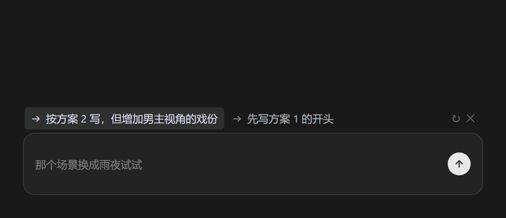

# dsh-followup

[](https://github.com/saul-dsh/dsh-followup/actions/workflows/ci.yml)
[](LICENSE)

dsh（DeepSeek Harness）的智能跟进推荐插件：**每轮对话结束后，输入框上方浮出 2-3 条可点击的跟进建议**，Trae「智能跟进推荐」同款交互。



## 效果

- 助手回复落定约 1-2 秒后，输入框上方浮出 chip，例如：

  ```
  [ 按方案 2 写，但增加男主视角的戏份 → ]  [ 先写方案 1 的开头 → ]  ↻  ✕
  ```

- **点击正文 / 箭头**：直接把这句建议发送出去（悬浮提示「发送」）——发送前整句会先在输入框里闪现，看得到发的是什么
- **点击气泡图标**：只把建议填进输入框草稿，编辑后再发（悬浮提示「添加到对话」）
- **↻ 换一批**：用同一轮上下文重新生成
- **✕ 关闭**：本轮不再打扰
- 只要一开始打字或发送，chip 自动消失

## 工作原理

1. 服务端只读运行时事件拼出「最近一轮」对话尾部：`agent/pre-step` 抓用户消息，`agent/assistant-stream` 累积助手文本，`agent/status → idle` 判定回合落定（延迟缓冲 1.2 秒，多步工具回合的中间 idle 会自动作废）。
2. 用 dsh 自己的模型路由（跟随会话模型，或插件配置指定快模型）发一次轻量调用：上下文裁剪到用户 400 字符 + 助手 1200 字符，输出限 220 token，要求严格 JSON。
3. 结果按 seq 缓存；客户端在每次「生成中 → 空闲」翻转后拉取，seq 相同自动忽略。

安全边界：**只读对话、不改消息、不拦截发送、fail-silent**——模型超时、路由缺失、解析失败都静默放弃本轮，绝不影响正常对话。

## 安装

```sh
dsh plugin --profile web add D:\AIiteams\dsh插件\packages\dsh-followup
dsh plugin --profile desktop add D:\AIiteams\dsh插件\packages\dsh-followup
```

重启 dsh 生效。无需配置任何 API key——建议生成走 dsh 已配置的模型凭据。

## 配置

| 配置 | 默认 | 说明 |
|------|------|------|
| `enabled` | `true` | 总开关 |
| `provider` / `model` | 跟随会话 | 生成建议用的模型，建议配快模型降低延迟 |
| `timeoutMs` | `12000` | 单次生成超时 |
| `idleDelayMs` | `1200` | 回合落定后的缓冲时间 |
| `maxSuggestions` | `3` | 最多几条（2-3） |
| `userChars` / `assistantChars` | `400` / `1200` | 上下文裁剪上限 |
| `minAssistantChars` | `30` | 助手回复短于此不生成 |

## 故障排查

- **chip 不出现**：先确认回复确实结束、且助手回复长于 30 字符；再看服务端日志里 `[dsh-followup]` 有没有 `turn N: N suggestions`。有日志没 chip → 客户端问题（控制台搜 `[dsh-followup]`）；没日志 → 服务端没触发，检查 `minAssistantChars` 和模型路由。
- **建议质量差**：给插件配置指定一个更强的模型（`provider` + `model`）。
- **多步工具回合**：工具执行期间不会出建议，整回合落定后才出——这是刻意设计。

## 与 dsh 运行时的关系

本插件与其他 dsh 插件一样通过 `~\.dsh\profiles\{web,desktop}\package.json` 的 link 路径加载，详见仓库根 README。

## License

[MIT](LICENSE)
